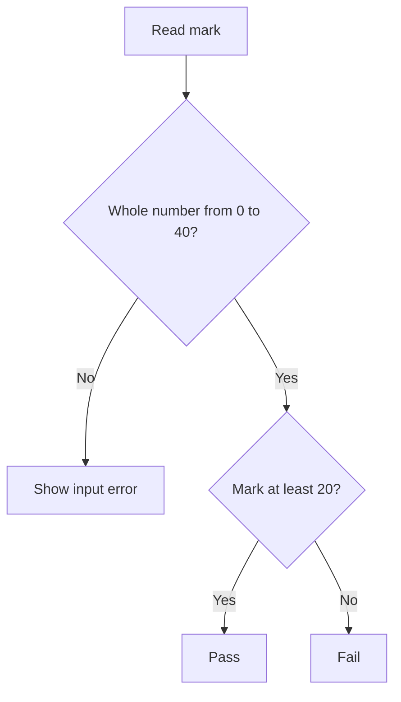

# Interactive lesson patterns

Pair a question with one useful visual or runnable example. Give the learner something to predict or change. After they reply, connect their reasoning to the evidence. Give a hint, explanation, or follow-up problem according to what they actually need. Keep questions and visuals in the learner’s chosen language where practical.

## Question cards

Use `**Question card · Predict**`, `Interpret`, `Debug`, `Sketch`, or `Teach back`. Show one question and a concise reply format. For open-ended questions, evaluate the learner’s reasoning in chat. For an explicitly requested objective multiple-choice quiz, use the host’s quiz feature if available. Independently check the correct answer, include plausible distractors and feedback, and hide the answer until a submission. If the host lacks that feature, list the options in Markdown and invite a reply. An interactive visual may check answers locally. Ask the learner to share their result or reasoning in chat for tutor feedback. A click alone may stay inside the visual.

**Question card · Interpret**

For marks `0, 19, 20, 40`, predict how the pass rate changes when the minimum rises from 20 to 21. Reply with the two rates and name which mark changes category. You can ask for a hint.

Tutor check after the attempt: two of four pass at 20, one of four at 21, and the mark of 20 changes category. For a hint, ask which of the four marks lies in the interval from 20 inclusive to 21 exclusive.

## Coding and diagrams

Give the learner a short runnable example, any input assumptions, the run command, and one prediction or edit. If the exercise is to repair a bug, label the intent and keep the repair for after the attempt. Include a test that exposes the issue. For language-agnostic lessons, plain Python is a useful default.

**Question card · Debug**

The rule is that a mark of 20 or higher passes. Save this deliberately flawed example as `pass_rate.py` and run `python pass_rate.py`. Which comparison would you change to make the assertion pass?

```python
def pass_rate(marks, cutoff=20):
    # This exercise assumes a nonempty list of valid marks.
    passing = sum(mark > cutoff for mark in marks)
    return 100 * passing / len(marks)


assert pass_rate([0, 19, 20, 40]) == 50
```

Use Mermaid for a decision, a sequence, a state change, or relationships. Keep the diagram compact and pair it with one prompt about a path or edge. If Mermaid does not render, describe the same paths in a short list. In a follow-up turn, this example can show the correct classification logic and ask for the path taken by `41`, `19`, or `20`.



## Charts and mathematical graphs

Use a native chart or a labeled plot when the learner needs to compare groups, follow a trend, or read a relationship. Use a bar chart for category comparisons, a line chart for ordered trends, and a scatter plot for paired observations. A function graph needs a stated equation, meaningful domain, and labeled axes. Distinguish measured data from synthetic teaching values. Verify plotted coordinates, labels, units, and computed values.

For a one-parameter investigation, render an inline interactive surface only if the host supports it. [Pass-rate example](pass-rate-card.html) is a self-contained HTML fragment with a threshold slider, two count bars, a choice question, and feedback after submission. To serve it in a lesson, use the host’s interactive output mechanism and the installed visualization guidance when available. Give the fragment a unique root ID if multiple instances share a rendered document. Copy or adapt it for the concept. Without an inline surface, use a rendered chart or concise data and ask the same question in chat.

When Python plotting is available, Matplotlib can produce a portable static graph. This example saves a comparison of two slopes. Ask the learner to predict the vertical gap at `x = 2` before inspecting the figure. Save it as `slopes.py` and run `python slopes.py` with Matplotlib installed.

```python
import matplotlib.pyplot as plt

x = [-2, -1, 0, 1, 2, 3]
figure, axes = plt.subplots()
axes.plot(x, x, label="y = x")
axes.plot(x, [2 * value for value in x], label="y = 2x")
axes.set(xlabel="x", ylabel="y")
axes.grid(alpha=0.25)
axes.legend()
figure.savefig("slopes.png", dpi=150, bbox_inches="tight")
```

## Short Manim animation

Use Manim Community when the timing or transformation is the point. This example draws two lines on the same axes. Ask the learner which line gains more vertical distance over the same horizontal step. Save as `slope_scene.py` and, with Manim Community available, render using `manim -ql slope_scene.py CompareSlopes`. Share the video only after it actually renders. Use the static slope graph if Manim is unavailable.

```python
from manim import Axes, BLUE, Create, Scene, YELLOW


class CompareSlopes(Scene):
    def construct(self):
        axes = Axes(x_range=[-2, 3, 1], y_range=[-4, 6, 2], tips=False)
        first = axes.plot(lambda x: x, x_range=[-2, 3], color=BLUE)
        second = axes.plot(lambda x: 2 * x, x_range=[-2, 3], color=YELLOW)
        self.add(axes)
        self.play(Create(first))
        self.play(Create(second))
        self.wait(1)
```

## Molecular diagrams and computational chemistry

Use RDKit or another verified molecular renderer for 2D bond structures. Check the input molecule and distinguish connectivity from 3D geometry and stereochemistry. The example draws ethanol from the SMILES `CCO`. Ask the learner to trace carbon-to-oxygen connectivity before revealing the image. Save it as `ethanol.py` and run `python ethanol.py` with RDKit installed.

```python
from rdkit import Chem
from rdkit.Chem import Draw

molecule = Chem.MolFromSmiles("CCO")
if molecule is None:
    raise ValueError("Invalid SMILES")
Draw.MolToFile(molecule, "ethanol.png", size=(320, 220))
```

If the learner requests ChemGraph, use a connected ChemGraph runtime or MCP tool when one is available. For example, let the learner predict what a geometry optimization changes, then compare the reported initial and optimized structures from the same molecular input. Record which method and inputs were actually used. A 2D structure may illustrate the molecule when a simulation cannot run. Report computation results only if the computation ran and produced them.

### Documentation

- [Mermaid flowcharts](https://mermaid.js.org/syntax/flowchart.html)
- [Matplotlib plotting tutorial](https://matplotlib.org/stable/tutorials/pyplot.html)
- [Manim Community quickstart](https://docs.manim.community/en/stable/tutorials/quickstart.html)
- [RDKit Python guide](https://www.rdkit.org/docs/GettingStartedInPython.html)
- [ChemGraph project](https://github.com/argonne-lcf/ChemGraph)
